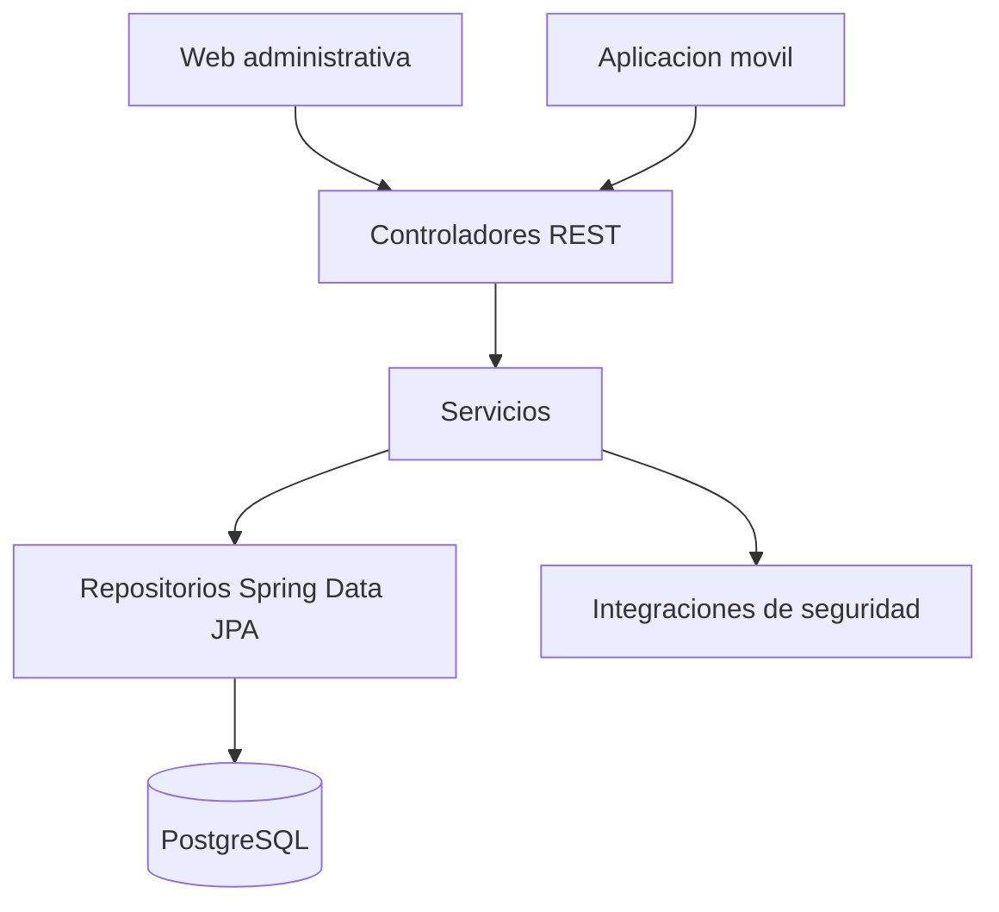

# Arquitectura del backend

## Diseño

Monolito Spring MVC por módulos y capas. Las solicitudes entran por controladores, pasan a servicios de negocio, usan repositorios JPA y llegan a PostgreSQL. Los DTOs evitan devolver entidades directamente.

## Capas y recorrido de una petición

| Capa | Responsabilidad |
|---|---|
| Controlador (`*.controller`) | Traduce HTTP: valida formato de entrada y devuelve el código HTTP. No contiene reglas de negocio. |
| Servicio (`*.service`) | Reglas de negocio, transacciones y conversión a DTO. |
| Repositorio (`*.repository`) | Acceso a datos con Spring Data JPA (Hibernate). |
| Entidad (`*.entity`) | Modelo persistente; no depende de capas superiores. |

Recorrido: cliente → (filtro de seguridad, cuando se integre) → controlador → servicio → repositorio → PostgreSQL → servicio (DTO) → controlador → respuesta JSON. Los errores se convierten a un formato uniforme en `GlobalExceptionHandler`. `ArchitectureTest` verifica estas dependencias.

## Clases principales

| Clase | Responsabilidad |
|---|---|
| `CiudadanoController` | API de registro, listado, detalle y actualización |
| `CiudadanoService` | Fechas, unicidad, búsqueda y actualización |
| `CiudadanoRepository` | Consultas sobre ciudadanos |
| `AntecedenteService` | Consultar o establecer estado ficticio |
| `AntecedenteRepository` | Consultas del estado y filtro para reportes |
| `CatalogoService` | Fuerzas públicas, rangos y coherencia de catálogos |
| `PersonalService` | Orquestar registro sin implementar credenciales ni correo |
| `RegistroPersonalIntegracion` | Contrato de validación, credenciales y correo del registro de personal |
| `AutenticacionIntegracion` | Contrato de login y logout |
| `ReporteService` | Composición del PDF con datos consultados |
| `GlobalExceptionHandler` | Estructura y códigos de error HTTP |
| `ArchitectureTest` | Verificación automática de dependencias entre capas y módulos |

## Decisiones de negocio

La identificación es `String` para evitar pérdidas de ceros iniciales y se valida como 6–10 dígitos. No existe un endpoint para eliminar ciudadanos. La identificación no se cambia en la edición.

El estado de antecedentes se guarda en una tabla separada con un registro por ciudadano. La ausencia de registro devuelve `404 SIN_INFORMACION` y jamás se interpreta como `NO_REQUERIDO`. La fuente es `SIMULADA`.

`PUT /api/antecedentes/{identificacion}/estado` es una operación adicional para las demostraciones, no forma parte literal del enunciado. Debe limitarse a administradores cuando se habilite seguridad.

Las migraciones V1 y V2 se aplican siempre. V100 solo se incluye con perfil `demo`. Las entidades JPA se validan contra el esquema y no lo generan automáticamente.
