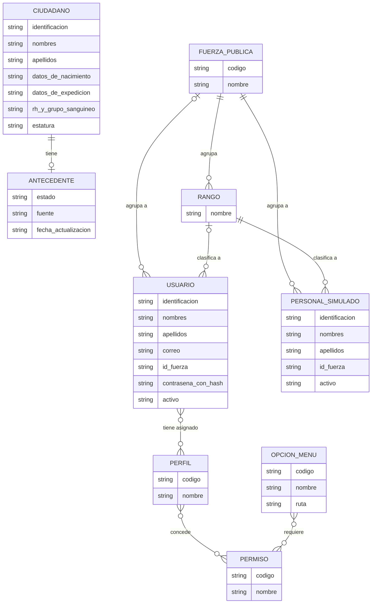

# Modelo conceptual — Sistema de Consulta Ciudadano

El modelo conceptual muestra las **entidades** del negocio y cómo se relacionan, sin detalles técnicos: no hay tipos de datos, claves foráneas ni tablas intermedias. Las relaciones muchos a muchos se dibujan directamente. El modelo entidad-relación (`modelo-er.md`) es su versión detallada, tal como existe en PostgreSQL.

## Diagrama

`PERSONAL_SIMULADO` corresponde a la tabla `defensa_personal_simulado`: el listado **ficticio** que reemplaza la consulta al Departamento de Defensa.

## Cómo se lee

- **Ciudadano y antecedente.** Un ciudadano tiene como máximo un estado de antecedentes (REQUERIDO o NO_REQUERIDO). Si no tiene, significa «sin información».
- **Fuerza pública y rango.** Cada fuerza tiene varios rangos. Un usuario puede pertenecer a una fuerza y tener un rango, o no tener ninguno (el administrador inicial).
- **Usuario, perfil y permiso.** Un usuario puede tener varios perfiles, y cada perfil concede varios permisos. Las opciones del menú aparecen según los permisos que las habilitan.
- **Personal simulado.** Es el dato contra el que se valida el registro de nuevo personal. Cada integrante simulado pertenece a una fuerza y tiene un rango.

## Lo que este modelo deja fuera

Las tablas `token_revocado`, `auth_login_intento` y `auth_registro_intento` son de apoyo técnico a la seguridad (cierre de sesión, bloqueo de login y límite de registros). No representan conceptos del negocio, por eso solo aparecen en el modelo entidad-relación.
