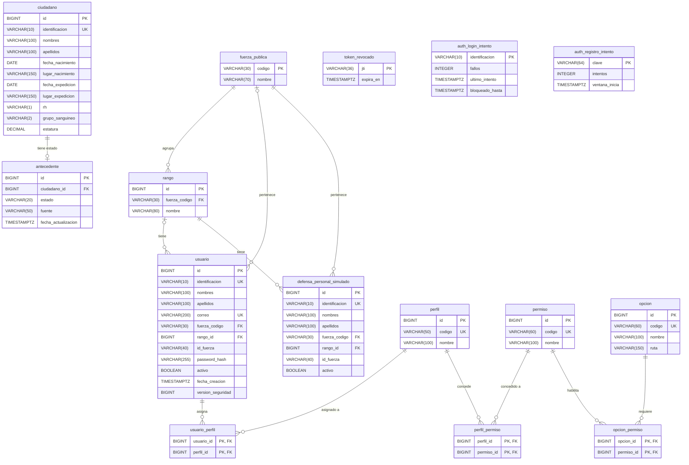

# Modelo entidad-relación — Sistema de Consulta Ciudadano

Base de datos: PostgreSQL. El esquema se crea con migraciones Flyway versionadas (V1 a V7) en `proyecto/backend/src/main/resources/db/migration/`. Este diagrama refleja el estado de esas migraciones.

Todos los datos de demostración son **ficticios** (perfil `demo`).

## Diagrama

En el diagrama, `estatura` aparece como `DECIMAL`. En la base de datos es `NUMERIC(3,2)`, con valores entre 0.50 y 2.50 metros.

## Cómo leerlo

- **PK** es clave primaria, **FK** es clave foránea y **UK** es valor único.
- Un ciudadano tiene **como máximo un** antecedente (`antecedente.ciudadano_id` es único). Un ciudadano sin fila en `antecedente` significa «sin información» y nunca se interpreta como NO_REQUERIDO.
- La relación de `usuario` con `fuerza_publica` y con `rango` es **opcional** (el símbolo con círculo junto a `fuerza_publica` y `rango`): el administrador inicial no pertenece a ninguna fuerza. En `defensa_personal_simulado` sí es obligatoria.
- `usuario` se relaciona con `perfil` mediante `usuario_perfil`. `perfil` se relaciona con `permiso` mediante `perfil_permiso`. `opcion` (opción de menú) se relaciona con `permiso` mediante `opcion_permiso`. Son tres relaciones muchos a muchos.
- `defensa_personal_simulado` es el dataset **ficticio** que simula al Departamento de Defensa. El registro de personal se valida contra él.
- Las tablas `token_revocado`, `auth_login_intento` y `auth_registro_intento` son de apoyo a la seguridad (logout, bloqueo de login y límite de registros). No tienen clave foránea. `auth_login_intento.identificacion` coincide por valor con `usuario.identificacion`, pero no se declara como FK.

## Reglas principales del modelo

| Regla | Dónde se aplica |
|---|---|
| Identificación única de ciudadano | `ciudadano.identificacion` UNIQUE |
| Identificación y correo únicos de usuario | `usuario.identificacion` y `usuario.correo` UNIQUE |
| Un estado de antecedente por ciudadano | `antecedente.ciudadano_id` UNIQUE |
| Estados válidos | CHECK `estado IN ('REQUERIDO','NO_REQUERIDO')` |
| Rango sin repetirse dentro de una fuerza | UNIQUE `(fuerza_codigo, nombre)` en `rango` |
| Fecha de expedición posterior al nacimiento | CHECK en `ciudadano` |
