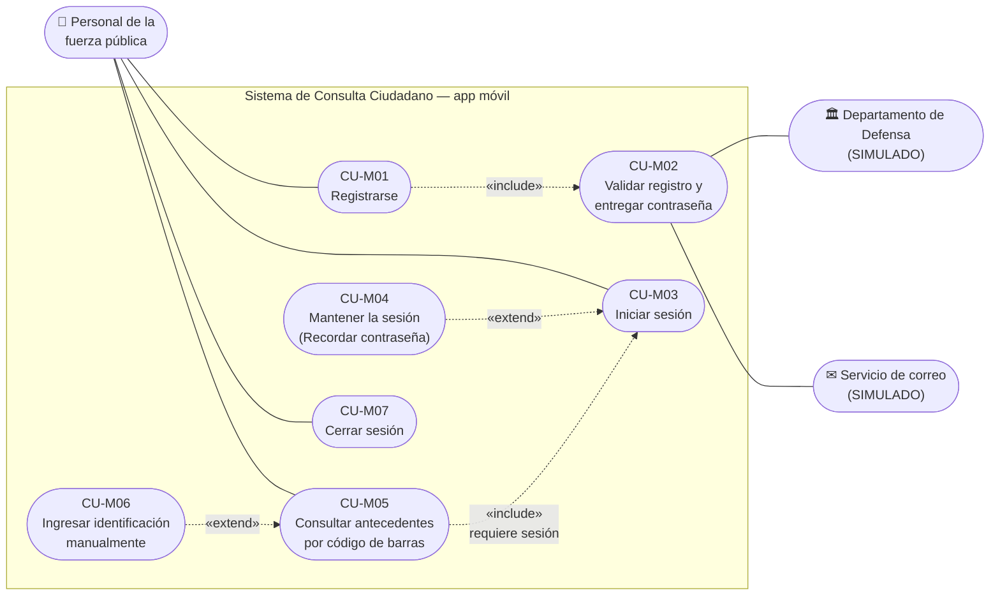

# Casos de uso — Personal de la fuerza pública (app móvil)

Diagrama y especificación de los casos de uso del actor **Personal de la fuerza pública** (A01). Cubre las historias HU01, HU02, HU03 y HU07 (RF01 a RF04) y sus criterios de aceptación CA01 a CA14 y CA26 a CA30 de `Proyecto_Final.xlsx`. Los casos de uso del Administrador (ciudadanos, reportes, usuarios y perfiles) se documentan en el módulo web.

## Diagrama de casos de uso

El Departamento de Defensa y el servicio de correo son actores externos **simulados** (dataset ficticio y SMTP de pruebas Mailpit); la app nunca habla con ellos directamente, solo con el backend.

## Resumen

| Id | Caso de uso | Historia | Requisito | Criterios | Pantalla |
|---|---|---|---|---|---|
| CU-M01 | Registrarse | HU01 | RF01 | CA01–CA04 | Registro |
| CU-M02 | Validar registro y entregar contraseña | HU02 | RF02 | CA05–CA09 | Registro (lo ejecuta el backend) |
| CU-M03 | Iniciar sesión | HU03 | RF03 | CA10–CA13 | Login |
| CU-M04 | Mantener la sesión («Recordar contraseña») | HU03 | RF03 | CA14 | Login |
| CU-M05 | Consultar antecedentes por código de barras | HU07 | RF04 | CA26–CA30 | Escáner y Resultado |
| CU-M06 | Ingresar identificación manualmente | HU07 | RF04 | CA30 | Escáner |
| CU-M07 | Cerrar sesión | HU03 | RF03 | — | Inicio |

## CU-M01 — Registrarse

| | |
|---|---|
| **Actor principal** | Personal de la fuerza pública |
| **Propósito** | Solicitar acceso al sistema ingresando los datos principales. |
| **Precondiciones** | La app tiene conexión con el backend. El usuario no tiene sesión iniciada. |
| **Postcondición de éxito** | La solicitud queda enviada al backend y se ejecuta CU-M02. |
| **Disparador** | El usuario toca **Registrarme** en la pantalla de inicio de sesión. |

**Flujo principal**

1. La app carga el catálogo de fuerzas y rangos desde el backend (`GET /api/catalogos/fuerzas-rangos`).
2. El usuario ingresa identificación, nombres, apellidos, fuerza pública, rango, ID Fuerza y correo electrónico. La lista de rangos muestra solo los de la fuerza elegida.
3. El usuario envía el formulario.
4. La app valida los campos obligatorios y los formatos.
5. La app envía los datos (`POST /api/personal/registro`) y muestra el estado **pendiente** mientras espera.
6. Se ejecuta CU-M02 y la app muestra el resultado.

**Flujos alternos**

- **1a. No se puede cargar el catálogo.** La app muestra el error y un botón para reintentar; no se puede enviar el formulario sin fuerza y rango.
- **2a. El usuario cambia de fuerza.** La app descarta el rango elegido y pide seleccionarlo de nuevo.
- **4a. Faltan campos o hay formatos inválidos** (identificación que no sea de 6 a 10 dígitos, correo mal formado). La app marca cada campo con su mensaje y no envía nada (CA02).
- **5a. Sin conexión o tiempo de espera agotado.** La app muestra un mensaje específico y permite reintentar sin perder lo digitado.

**Reglas**: la validación de la app es una ayuda; el backend valida de nuevo y es quien decide.

## CU-M02 — Validar registro y entregar contraseña

| | |
|---|---|
| **Actor principal** | Personal de la fuerza pública (inicia); Departamento de Defensa y servicio de correo, ambos SIMULADOS (participan) |
| **Propósito** | Confirmar que la persona pertenece a la fuerza pública y entregarle su contraseña. |
| **Precondiciones** | CU-M01 envió un formulario válido. |
| **Postcondición de éxito** | Existe una cuenta con la contraseña guardada solo como hash; la contraseña llegó al correo registrado. |

**Flujo principal**

1. El backend valida formato y unicidad de los datos.
2. El backend consulta el validador de Defensa (SIMULADO) con identificación, nombres, apellidos, fuerza, rango e ID Fuerza.
3. Defensa confirma los datos.
4. El backend genera una contraseña de exactamente 6 caracteres con al menos una mayúscula, una minúscula y un número, y guarda solo su hash.
5. El backend envía la contraseña al correo registrado.
6. La app muestra **registro aceptado** e indica que la contraseña llegará por correo.

**Flujos alternos**

- **1a. La identificación ya está registrada.** El backend responde 409 y la app muestra **registro rechazado** con el motivo (CA03).
- **3a. Defensa no valida los datos.** El backend responde 400 con un mensaje genérico (no revela qué dato falló) y la app muestra **registro rechazado** (CA09).
- **2a. La validación no está disponible.** El backend responde 503 y la app informa que la función no está disponible, sin dar el registro por hecho.
- **1b. Demasiados intentos desde el mismo origen.** El backend limita los intentos de registro; la app muestra el mensaje del servidor.

**Reglas**: la respuesta de la API nunca incluye la contraseña; la app nunca la muestra ni la almacena (supuestos SEG-01, MOV-02 y MOV-05).

## CU-M03 — Iniciar sesión

| | |
|---|---|
| **Actor principal** | Personal de la fuerza pública |
| **Propósito** | Autenticarse para usar la consulta de antecedentes. |
| **Precondiciones** | El usuario tiene una cuenta (CU-M02) y conoce la contraseña recibida por correo. |
| **Postcondición de éxito** | La app tiene un token de sesión vigente en memoria y muestra el flujo principal. |
| **Disparador** | El usuario abre la app sin sesión guardada, o su sesión venció. |

**Flujo principal**

1. El usuario ingresa identificación y contraseña.
2. El usuario toca **Iniciar sesión**.
3. La app envía las credenciales (`POST /api/auth/login`).
4. El backend valida las credenciales y responde con un token y su vigencia.
5. La app guarda el token en memoria y reemplaza el flujo de acceso por el flujo principal (Inicio).

**Flujos alternos**

- **2a. Campos vacíos o identificación con formato inválido.** La app lo indica y no envía.
- **4a. Credenciales incorrectas.** El backend responde 401 con un mensaje genérico; la app lo muestra y no permite el acceso (CA13).
- **4b. Cuenta bloqueada por intentos fallidos.** El backend bloquea temporalmente la identificación; la app muestra el mensaje del servidor.
- **3a. Sin conexión, tiempo de espera o respuesta inesperada.** La app muestra un mensaje específico para cada caso.

## CU-M04 — Mantener la sesión («Recordar contraseña»)

| | |
|---|---|
| **Actor principal** | Personal de la fuerza pública |
| **Propósito** | No tener que escribir las credenciales cada vez que se abre la app en el mismo dispositivo. |
| **Precondiciones** | El usuario está en CU-M03. |
| **Postcondición de éxito** | El token (nunca la contraseña) queda en el almacenamiento seguro del dispositivo hasta que venza o se cierre la sesión. |

**Flujo principal**

1. El usuario activa **Recordar contraseña** antes de ingresar.
2. La app envía `recordarContrasena: true`; el backend emite un token de mayor duración.
3. La app guarda el token y su vencimiento en `expo-secure-store` (Keystore en Android, Keychain en iOS).
4. Al abrir la app de nuevo, esta lee el token guardado y, si sigue vigente, entra directo al flujo principal.

**Flujos alternos**

- **1a. La opción está desactivada.** El token vive solo en memoria y se borra cualquier sesión guardada; al cerrar la app hay que iniciar sesión otra vez.
- **4a. El token guardado ya venció.** La app lo borra, informa que la sesión venció y pide iniciar sesión.
- **4b. El backend rechaza el token (401) en cualquier consulta.** La app interpreta sesión vencida o revocada, borra el token y vuelve al login.
- **3a. El almacenamiento seguro falla.** La sesión sigue activa en memoria y la app avisa que no se pudo guardar para la próxima apertura.

**Reglas**: la contraseña no se guarda en ningún lugar del dispositivo (supuestos SEG-02 y MOV-02).

## CU-M05 — Consultar antecedentes por código de barras

| | |
|---|---|
| **Actor principal** | Personal de la fuerza pública |
| **Propósito** | Saber en campo si un ciudadano está Requerido o No requerido. |
| **Precondiciones** | Sesión iniciada (CU-M03). |
| **Postcondición de éxito** | La app muestra el estado que devolvió el backend para la identificación leída. |
| **Disparador** | El usuario toca **Escanear cédula** en Inicio. |

**Flujo principal**

1. La app solicita el permiso de cámara si aún no lo tiene.
2. El usuario concede el permiso y la app abre la cámara con un marco guía.
3. El usuario apunta al código de barras de la cédula.
4. La app lee el símbolo y extrae la identificación (cadena de 6 a 10 dígitos tras quitar espacios, puntos y guiones).
5. La app consulta el backend (`GET /api/antecedentes/{identificacion}`) con el token.
6. La app muestra **REQUERIDO** o **NO REQUERIDO**, tal como lo devolvió el backend.
7. El usuario escanea otra cédula o vuelve al inicio.

**Flujos alternos**

- **2a. El usuario niega el permiso de cámara.** La app explica cómo concederlo desde los ajustes y ofrece CU-M06.
- **4a. El código no se puede interpretar como identificación.** La app avisa **código no legible** y permite reintentar o pasar a CU-M06 (CA30).
- **3a. El usuario cancela.** La app vuelve a Inicio sin consultar.
- **6a. No hay información para esa identificación** (ciudadano inexistente o sin estado; 404 `SIN_INFORMACION`). La app muestra un aviso de **sin información** y aclara que eso no equivale a «No requerido» (CA30).
- **5a. Sin conexión, tiempo de espera o error del servidor.** La app muestra un mensaje distinto para cada caso y un botón **Reintentar**.
- **5b. Sesión vencida o revocada (401).** La app vuelve al login (CU-M04, flujo 4b).

**Reglas**: la app no decide el estado ni lo infiere; solo envía la identificación y presenta la respuesta (supuestos SIM-03 y DAT-04). Los datos de antecedentes son ficticios y su fuente es `SIMULADA`.

## CU-M06 — Ingresar identificación manualmente

| | |
|---|---|
| **Actor principal** | Personal de la fuerza pública |
| **Propósito** | Consultar cuando el escáner no puede usarse o no lee el código. |
| **Precondiciones** | Sesión iniciada; el usuario está en la pantalla del escáner. |
| **Postcondición de éxito** | Se continúa en el paso 5 de CU-M05 con la identificación digitada. |

**Flujo principal**

1. El usuario toca **Ingresar identificación manualmente**.
2. El usuario escribe la identificación y confirma.
3. La app valida que tenga solo números, entre 6 y 10 dígitos.
4. Se continúa en el paso 5 de CU-M05.

**Flujos alternos**

- **3a. Formato inválido.** La app muestra el error en el campo y no consulta.

## CU-M07 — Cerrar sesión

| | |
|---|---|
| **Actor principal** | Personal de la fuerza pública |
| **Propósito** | Terminar la sesión en el dispositivo. |
| **Precondiciones** | Sesión iniciada. |
| **Postcondición de éxito** | El token queda revocado en el servidor y borrado de la memoria y del almacenamiento seguro. |

**Flujo principal**

1. El usuario toca **Cerrar sesión** en Inicio.
2. La app pide al backend revocar el token (`POST /api/auth/logout`).
3. La app borra el token de la memoria y del almacenamiento seguro, aunque «Recordar contraseña» estuviera activo.
4. La app muestra el flujo de acceso (Login).

**Flujos alternos**

- **2a. Sin conexión.** La sesión se cierra localmente de todos modos; el token deja de usarse en el dispositivo y vence solo en el servidor.
