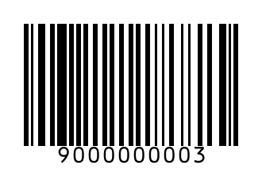
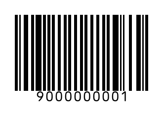
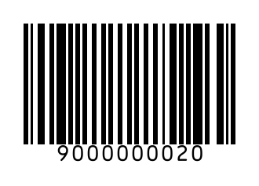
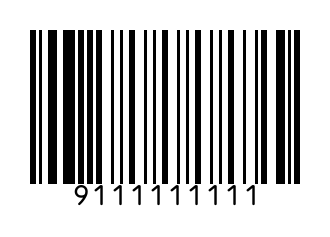
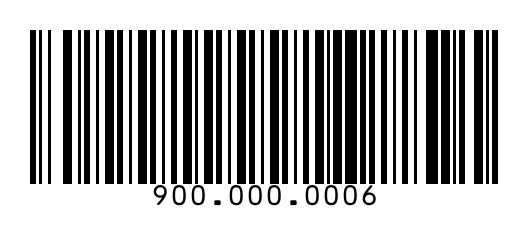
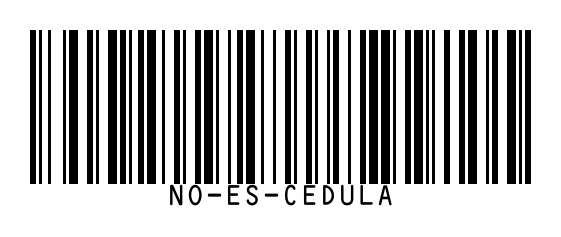
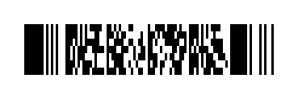

# Códigos de barras de prueba

Códigos generados a partir de las identificaciones **ficticias** del dataset demo del backend (`backend/src/main/resources/db/demo/V100__datos_ficticios.sql`). No corresponden a cédulas reales (supuestos S-04 y S-10). Sirven para probar el escáner en dispositivo o emulador: abre esta página en otra pantalla, o imprímela, y apunta la cámara al código.

El estado esperado es el que devuelve el backend con el perfil `demo`; la app solo lo muestra.

| Caso | Código | Contenido | Resultado esperado en la app |
|---|---|---|---|
| Ciudadano requerido |  | `9000000003` (Code 128) | Insignia **REQUERIDO** |
| Ciudadano no requerido |  | `9000000001` (Code 128) | Insignia **NO REQUERIDO** |
| Ciudadano sin estado registrado |  | `9000000020` (Code 128) | Aviso **sin información** (404 `SIN_INFORMACION`), nunca «No requerido» |
| Identificación que no existe |  | `9111111111` (Code 128) | Aviso **sin información** |
| Identificación con separadores |  | `900.000.0006` (Code 128) | Se limpian los puntos y se consulta `9000000006` → **REQUERIDO** |
| Código que no es una cédula |  | `NO-ES-CEDULA` (Code 128) | Aviso de **código no legible**, con reintento e ingreso manual |
| Símbolo PDF417 |  | `9000000009` (PDF417) | Insignia **REQUERIDO** |

Otras identificaciones del seed: `9000000001` a `9000000019` tienen estado (son REQUERIDO las múltiplos de tres: 3, 6, 9, 12, 15 y 18); `9000000020` no tiene estado a propósito.

## Cómo se generaron

Con la librería `bwip-js` (no es dependencia de la app; se usó solo para producir estas imágenes):

```js
const bwip = require('bwip-js');
const svg = bwip.toSVG({ bcid: 'code128', text: '9000000003', scale: 3, height: 18, includetext: true });
```

Para probar otra identificación basta repetir el comando con otro `text`, o `bcid: 'pdf417'` para el símbolo bidimensional.
