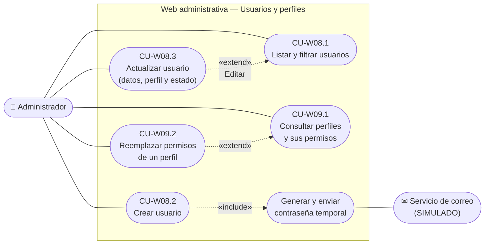

# Casos de uso — Usuarios y perfiles (MVP 2)

> **Estado: borrador por revisar con Julián (seguridad).** Las reglas se tomaron del backend ya implementado
> (`UsuarioService`, `PerfilService` y el contrato OpenAPI de `/api/usuarios`, `/api/perfiles` y `/api/permisos`).
> **La pantalla web todavía no existe**: los pasos de interfaz describen la propuesta del prototipo
> [mockups/usuarios-perfiles.svg](mockups/usuarios-perfiles.svg), no algo ya construido.

Especificación de los casos CU-W08 y CU-W09 del actor **Administrador**, que cubren las historias HU08 y HU09
(RF06: gestionar usuarios, perfiles, opciones y permisos). El diagrama general y las condiciones comunes (sin sesión,
401, 403 y API caída) están en [casos-de-uso.md](casos-de-uso.md).

## Diagrama

## Resumen

| Id | Caso de uso | API | Pantalla web |
|---|---|---|---|
| CU-W08.1 | Listar y filtrar usuarios | `GET /api/usuarios?estado=&perfil=&page=&size=` | Pendiente |
| CU-W08.2 | Crear usuario | `POST /api/usuarios` | Pendiente |
| CU-W08.3 | Actualizar usuario | `GET` y `PUT /api/usuarios/{identificacion}` | Pendiente |
| CU-W09.1 | Consultar perfiles y sus permisos | `GET /api/perfiles`, `GET /api/permisos`, `GET /api/perfiles/{id}/permisos` | Pendiente |
| CU-W09.2 | Reemplazar permisos de un perfil | `PUT /api/perfiles/{id}/permisos` | Pendiente |

Todas las rutas exigen el perfil ADMINISTRADOR en el backend (ver
[matriz de rol y permiso](../../backend/docs/decisiones/matriz-rol-permiso.md)).

## Reglas de negocio

| Id | Regla | Respuesta de la API |
|---|---|---|
| RN1 | No se eliminan usuarios; se desactivan (estado INACTIVO) | No existe `DELETE` |
| RN2 | La identificación y el correo son únicos | 409 `DUPLICADO` |
| RN3 | La contraseña temporal la genera el sistema y se envía por correo (SIMULADO); nunca se muestra ni se devuelve | — |
| RN4 | Un administrador no puede desactivarse ni quitarse su propio perfil | 409 `AUTODESACTIVACION_NO_PERMITIDA` |
| RN5 | Debe quedar al menos un administrador activo | 409 `ULTIMO_ADMIN_ACTIVO` |
| RN6 | El catálogo de perfiles es fijo: ADMINISTRADOR y PERSONAL_FUERZA_PUBLICA. No se crean ni se borran perfiles | — |
| RN7 | El perfil ADMINISTRADOR debe conservar el permiso «Administrar usuarios y perfiles» (`SEGURIDAD_ADMINISTRAR`) | 409 `PERMISOS_ADMIN_REQUERIDOS` |
| RN8 | Las respuestas nunca incluyen contraseñas ni sus hashes | — |

## CU-W08.1 — Listar y filtrar usuarios

| | |
|---|---|
| **Actor principal** | Administrador |
| **Propósito** | Ver quién tiene acceso al sistema, con qué perfil y en qué estado. |
| **Precondiciones** | Sesión iniciada como administrador. |
| **Postcondición de éxito** | La web muestra los usuarios que cumplen el filtro. |
| **Disparador** | El administrador abre **Usuarios y perfiles**. |

**Flujo principal**

1. La web pide la primera página de usuarios a la API y muestra identificación, nombres, apellidos, correo, perfil y estado.
2. El administrador filtra por perfil, por estado o por ambos.
3. La web muestra los usuarios que coinciden, de a 20 por página, ordenados por identificación.

**Flujos alternos**

- **3a. Ningún usuario cumple el filtro.** La web muestra un mensaje de «sin resultados» y permite quitar el filtro.

## CU-W08.2 — Crear usuario

| | |
|---|---|
| **Actor principal** | Administrador |
| **Actor secundario** | Servicio de correo (SIMULADO) |
| **Propósito** | Dar acceso al sistema a una persona, asignándole un perfil. |
| **Precondiciones** | Sesión iniciada como administrador. |
| **Postcondición de éxito** | El usuario queda creado en estado ACTIVO y recibe su contraseña temporal por correo. |
| **Disparador** | El administrador pulsa **Crear usuario**. |

**Flujo principal**

1. La web muestra el formulario: identificación, nombres, apellidos, correo y perfil.
2. El administrador diligencia los campos y envía el formulario.
3. La web valida: identificación de 6 a 10 dígitos, nombres y apellidos de máximo 100 caracteres, correo con formato
   válido y máximo 200 caracteres, y perfil elegido.
4. La web envía los datos a la API (`POST /api/usuarios`).
5. La API crea el usuario, genera una contraseña temporal, guarda solo su hash y la envía al correo indicado.
6. La web confirma la creación e indica que la contraseña llega por correo (RN3).

**Flujos alternos**

- **3a. Hay campos vacíos o inválidos.** La web marca cada campo con su mensaje y conserva lo escrito.
- **5a. La identificación o el correo ya están registrados** (RN2). La web muestra el mensaje en el campo correspondiente.
- **5b. El perfil no existe** (404). La web lo informa y recarga la lista de perfiles.
- **5c. El servicio de correo no está disponible** (503). La web informa que no se pudo completar la creación y que
  debe intentarse de nuevo.

## CU-W08.3 — Actualizar usuario

| | |
|---|---|
| **Actor principal** | Administrador |
| **Propósito** | Corregir los datos de un usuario, cambiarle el perfil, o desactivarlo y reactivarlo. |
| **Precondiciones** | Sesión iniciada como administrador. El usuario existe. |
| **Postcondición de éxito** | Los cambios quedan guardados. Si cambió el perfil o el estado, los tokens anteriores del usuario dejan de servir. |
| **Disparador** | El administrador pulsa **Editar** sobre un usuario del listado. |

**Flujo principal**

1. La web pide el usuario a la API y muestra el formulario precargado, con la identificación bloqueada.
2. El administrador cambia nombres, apellidos, correo, perfil o estado (ACTIVO / INACTIVO) y guarda.
3. La web valida los campos como en CU-W08.2.
4. La web envía los cambios a la API (`PUT /api/usuarios/{identificacion}`).
5. La web confirma «Cambios guardados» y vuelve al listado.

**Flujos alternos**

- **4a. El correo ya pertenece a otro usuario** (RN2). La web lo muestra en el campo correo.
- **4b. El administrador intenta desactivarse o quitarse su propio perfil** (RN4). La web muestra «Un administrador
  no puede desactivarse ni quitarse su perfil» y no guarda.
- **4c. El cambio dejaría el sistema sin administradores activos** (RN5). La web muestra «Debe permanecer al menos
  un administrador activo» y no guarda.
- **1a. El usuario ya no existe** (404). La web lo informa y vuelve al listado.

## CU-W09.1 — Consultar perfiles y sus permisos

| | |
|---|---|
| **Actor principal** | Administrador |
| **Propósito** | Saber qué puede hacer cada perfil. |
| **Precondiciones** | Sesión iniciada como administrador. |
| **Postcondición de éxito** | La web muestra los permisos del perfil elegido. |
| **Disparador** | El administrador abre la pestaña **Perfiles y permisos**. |

**Flujo principal**

1. La web pide a la API los perfiles y el catálogo completo de permisos.
2. El administrador elige un perfil.
3. La web pide los permisos de ese perfil y los muestra marcados sobre el catálogo completo.

Catálogo actual de permisos: consultar ciudadanos, registrar ciudadanos, actualizar ciudadanos, consultar
antecedentes, actualizar estados de demostración, generar reportes y administrar usuarios y perfiles.

## CU-W09.2 — Reemplazar permisos de un perfil

| | |
|---|---|
| **Actor principal** | Administrador |
| **Propósito** | Ajustar lo que un perfil puede hacer. |
| **Precondiciones** | Sesión iniciada como administrador. Se está consultando un perfil (CU-W09.1). |
| **Postcondición de éxito** | El perfil queda exactamente con los permisos marcados. |
| **Disparador** | El administrador marca o desmarca permisos y pulsa **Guardar permisos**. |

**Flujo principal**

1. El administrador marca los permisos que debe tener el perfil.
2. La web envía la lista completa a la API (`PUT /api/perfiles/{id}/permisos`); la lista reemplaza a la anterior.
3. La API guarda los permisos.
4. La web confirma el cambio y muestra los permisos actualizados.

**Flujos alternos**

- **2a. Se intenta quitar «Administrar usuarios y perfiles» al perfil ADMINISTRADOR** (RN7). La web muestra ese
  permiso bloqueado; si aun así llega la petición, la API responde 409 y la web muestra el mensaje.
- **3a. Algún permiso ya no existe** (404). La web recarga el catálogo y pide repetir la selección.

## Pendientes por acordar con Julián

1. Si la web muestra las **opciones de menú** (`opcion`, `opcion_permiso`) o solo los permisos por perfil.
2. Si al crear un usuario con perfil PERSONAL_FUERZA_PUBLICA desde la web se piden fuerza, rango e ID Fuerza
   (hoy `POST /api/usuarios` no los recibe; ese registro se hace desde la app móvil).
3. El texto exacto de los mensajes de la web para los códigos 409 de las reglas RN4, RN5 y RN7.
4. Qué historia (HU08 o HU09) y qué criterios de aceptación corresponden a cada caso, según el libro
   `00_Consolidado_Entrega.xlsx`.
