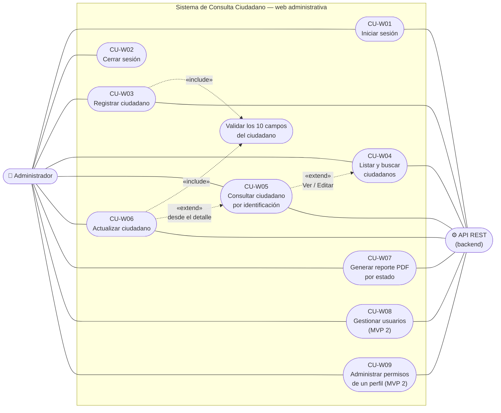

# Casos de uso — Administrador (web administrativa)

Diagrama y especificación de los casos de uso del actor **Administrador**. Cubre las historias HU04 a HU06
(ciudadanos, RF05), HU10 (reporte PDF, RF07) y el ingreso del administrador (RF03). Los casos de usuarios, perfiles
y permisos (HU08 y HU09, RF06) aparecen en el diagrama y se especifican en
[casos-de-uso-usuarios-perfiles.md](casos-de-uso-usuarios-perfiles.md). Los casos del personal de la fuerza pública
están en [el módulo móvil](../../mobile/docs/casos-de-uso.md).

La numeración de los criterios de aceptación (CA) de cada historia está en el libro `00_Consolidado_Entrega.xlsx`,
junto con la trazabilidad; aquí se referencian la historia y el requisito.

## Diagrama de casos de uso

Todos los casos, salvo CU-W01, exigen una sesión iniciada como administrador (CU-W01). La web no accede a la base
de datos: cada caso se resuelve con una petición a la API REST, que es quien autoriza con el token.

## Resumen

| Id | Caso de uso | Historia | Requisito | Pantalla | Estado |
|---|---|---|---|---|---|
| CU-W01 | Iniciar sesión | — | RF03 | Login | Implementado |
| CU-W02 | Cerrar sesión | — | RF03 | Menú lateral | Implementado |
| CU-W03 | Registrar ciudadano | HU04 | RF05 | Registrar ciudadano | Implementado |
| CU-W04 | Listar y buscar ciudadanos | HU05 | RF05 | Panel y Listado | Implementado |
| CU-W05 | Consultar ciudadano por identificación | HU05 | RF05 | Panel, Listado y Detalle | Implementado |
| CU-W06 | Actualizar ciudadano | HU06 | RF05 | Editar ciudadano | Implementado |
| CU-W07 | Generar reporte PDF por estado | HU10 | RF07 | Reportes | Implementado |
| CU-W08 | Gestionar usuarios | HU08 y HU09 | RF06 | Usuarios y perfiles | Solo API; pantalla pendiente |
| CU-W09 | Administrar permisos de un perfil | HU08 y HU09 | RF06 | Usuarios y perfiles | Solo API; pantalla pendiente |

Los prototipos de cada pantalla están en [mockups.md](mockups.md) y los casos de prueba en [pruebas.md](pruebas.md).

## Condiciones comunes

Aplican a CU-W02 en adelante y no se repiten en cada caso:

- **Sin sesión:** cualquier pantalla redirige al login.
- **La API responde 401** (token vencido o revocado): se cierra la sesión local y se vuelve al login con
  «Su sesión expiró. Ingrese de nuevo.»
- **La API responde 403** (el usuario ya no tiene el rol): se cierra la sesión y se vuelve al login con
  «Su usuario no tiene permisos de administrador.»
- **La API no responde** (caída, red o tiempo agotado): se muestra «No fue posible conectar con el servidor.
  Intente de nuevo en unos minutos.» con la opción **Reintentar**; no se pierde lo escrito en los formularios.

## CU-W01 — Iniciar sesión

| | |
|---|---|
| **Actor principal** | Administrador |
| **Propósito** | Entrar a la web administrativa con una cuenta de perfil ADMINISTRADOR. |
| **Precondiciones** | El administrador tiene una cuenta activa. La web tiene conexión con el backend. |
| **Postcondición de éxito** | Queda una sesión iniciada; el token se guarda en el servidor web, no en el navegador. |
| **Disparador** | El administrador abre la web o intenta abrir una pantalla sin sesión. |

**Flujo principal**

1. La web muestra el formulario de ingreso.
2. El administrador escribe su identificación y su contraseña y, si quiere, activa **Recordar contraseña**.
3. La web envía las credenciales a la API (`POST /api/auth/login`).
4. La API valida las credenciales y devuelve un token con su duración (15 minutos, u 8 horas con «Recordar contraseña»).
5. La web comprueba que el usuario es administrador con una consulta que exige ese rol.
6. La web inicia la sesión con la misma duración del token y muestra el panel principal.

**Flujos alternos**

- **2a. Falta la identificación o la contraseña.** La web muestra «Ingrese identificación y contraseña.» y no consulta la API.
- **4a. Credenciales incorrectas.** La web muestra «Identificación o contraseña incorrectas.», sin indicar cuál de las dos falló.
- **5a. El usuario no es administrador** (por ejemplo, personal de la fuerza pública). La web revoca el token, no deja
  sesión y muestra «Su usuario no tiene permisos de administrador.»
- **3a. La API no responde.** La web muestra el mensaje de conexión y permanece en el login.

## CU-W02 — Cerrar sesión

| | |
|---|---|
| **Actor principal** | Administrador |
| **Propósito** | Terminar la sesión para que nadie más use la web desde ese navegador. |
| **Precondiciones** | Sesión iniciada. |
| **Postcondición de éxito** | El token queda revocado en la API y la sesión web eliminada. |
| **Disparador** | El administrador pulsa **Cerrar sesión** en el menú lateral. |

**Flujo principal**

1. La web pide a la API revocar el token (`POST /api/auth/logout`).
2. La web elimina la sesión y muestra el login con «Sesión cerrada.»

**Flujos alternos**

- **1a. La API no responde o el token ya venció.** La sesión web se cierra igual.
- **2a. El administrador pulsa «Atrás» en el navegador.** No ve datos: las pantallas no se guardan en caché y la
  sesión ya no existe, así que vuelve al login.

## CU-W03 — Registrar ciudadano

| | |
|---|---|
| **Actor principal** | Administrador |
| **Propósito** | Incorporar un ciudadano al sistema con sus 10 datos. |
| **Precondiciones** | Sesión iniciada. |
| **Postcondición de éxito** | El ciudadano queda guardado y aparece en el listado. |
| **Disparador** | El administrador pulsa **Registrar ciudadano** en el menú, el panel o el listado. |

**Flujo principal**

1. La web muestra el formulario con los 10 campos: identificación, nombres, apellidos, fecha de nacimiento, lugar de
   nacimiento, fecha de expedición, lugar de expedición, grupo sanguíneo, RH y estatura.
2. El administrador diligencia los campos y envía el formulario.
3. La web valida los campos (ver reglas abajo), primero en el navegador y de nuevo en el servidor web.
4. La web envía los datos a la API (`POST /api/ciudadanos`).
5. La API guarda al ciudadano.
6. La web muestra el listado filtrado por esa identificación, con «Ciudadano registrado: …» y la fila resaltada.

**Flujos alternos**

- **3a. Hay campos vacíos o con formato inválido.** La web indica cuántos campos hay por corregir, marca cada uno
  con su mensaje y conserva lo escrito. No se envía nada a la API.
- **5a. La identificación ya existe** (409). La web muestra «Ya existe un ciudadano con esta identificación.» en ese campo.
- **5b. La API rechaza algún dato** (400). La web muestra cada mensaje en su campo.
- **4a. La API no responde.** La web muestra «…Los datos no se guardaron.» y conserva lo escrito.

**Reglas de los campos**

| Campo | Regla |
|---|---|
| Identificación | Obligatoria, 6 a 10 dígitos, sin puntos ni espacios |
| Nombres, apellidos | Obligatorios, máximo 100 caracteres, solo letras y espacios |
| Fecha de nacimiento | Obligatoria, no futura |
| Fecha de expedición | Obligatoria, no futura, posterior a la fecha de nacimiento |
| Lugar de nacimiento, lugar de expedición | Obligatorios, máximo 150 caracteres |
| Grupo sanguíneo | A, B, AB u O |
| RH | + o - |
| Estatura | 0.50 a 2.50 m, máximo 2 decimales |

## CU-W04 — Listar y buscar ciudadanos

| | |
|---|---|
| **Actor principal** | Administrador |
| **Propósito** | Ver los ciudadanos registrados y encontrar uno sin conocer su identificación completa. |
| **Precondiciones** | Sesión iniciada. |
| **Postcondición de éxito** | La web muestra los ciudadanos que coinciden, de a 20 por página. |
| **Disparador** | El administrador abre **Ciudadanos**. |

**Flujo principal**

1. La web pide la primera página a la API (`GET /api/ciudadanos`) y muestra la tabla con el total («Mostrando 1–20 de N»).
2. El administrador escribe parte de la identificación, de los nombres o de los apellidos y pulsa **Buscar**.
3. La web muestra solo los ciudadanos que coinciden.
4. El administrador cambia de página, o usa **Ver** (CU-W05) o **Editar** (CU-W06) sobre una fila.

**Flujos alternos**

- **1a. No hay ciudadanos.** La web muestra «Aún no hay ciudadanos registrados».
- **3a. Nadie coincide.** La web muestra «No hay resultados para …» y permite limpiar el filtro.
- **4a. Se pide una página que no existe.** La web muestra «La página solicitada no existe.»

## CU-W05 — Consultar ciudadano por identificación

| | |
|---|---|
| **Actor principal** | Administrador |
| **Propósito** | Ver todos los datos de un ciudadano a partir de su identificación. |
| **Precondiciones** | Sesión iniciada. |
| **Postcondición de éxito** | La web muestra el detalle del ciudadano. |
| **Disparador** | El administrador usa **Consultar por identificación** (panel o listado) o pulsa **Ver** en el listado. |

**Flujo principal**

1. El administrador escribe la identificación; puede llevar puntos o espacios (por ejemplo `9.000.000.001`).
2. La web limpia el número y pide el ciudadano a la API (`GET /api/ciudadanos/{identificacion}`).
3. La web muestra el detalle con los 10 datos agrupados y las acciones **Volver al listado** y **Editar**.

**Flujos alternos**

- **1a. Lo escrito no es una identificación** (letras, o menos de 6 o más de 10 dígitos). La web muestra
  «Identificación inválida…» en el listado y no consulta la API.
- **2a. No existe un ciudadano con esa identificación** (404). La web lo informa en el listado.

## CU-W06 — Actualizar ciudadano

| | |
|---|---|
| **Actor principal** | Administrador |
| **Propósito** | Corregir o actualizar los datos de un ciudadano ya registrado. |
| **Precondiciones** | Sesión iniciada. El ciudadano existe. |
| **Postcondición de éxito** | Los cambios quedan guardados. |
| **Disparador** | El administrador pulsa **Editar** en el listado o en el detalle. |

**Flujo principal**

1. La web pide el ciudadano a la API y muestra el formulario precargado, con la identificación bloqueada.
2. El administrador cambia los datos y pulsa **Guardar cambios**.
3. La web valida los campos con las mismas reglas de CU-W03.
4. La web envía los cambios a la API (`PUT /api/ciudadanos/{identificacion}`).
5. La web muestra el detalle con «Cambios guardados para …».

**Flujos alternos**

- **3a. Hay campos inválidos.** Igual que 3a de CU-W03.
- **2a. La identificación enviada no coincide con la del ciudadano que se edita.** La web rechaza la petición con
  «La identificación de un ciudadano no se puede modificar.» y no llama a la API.
- **1a. El ciudadano ya no existe** (404). La web lo informa en el listado.
- **4a. La API no responde.** La web muestra el error y conserva lo escrito.

## CU-W07 — Generar reporte PDF por estado

| | |
|---|---|
| **Actor principal** | Administrador |
| **Propósito** | Obtener en PDF la lista de ciudadanos con estado Requerido o No requerido. |
| **Precondiciones** | Sesión iniciada. |
| **Postcondición de éxito** | El administrador ve o descarga el PDF. No se modifica ningún dato. |
| **Disparador** | El administrador abre **Reportes**. |

**Flujo principal**

1. La web muestra el filtro con las opciones **Requerido** y **No requerido**.
2. El administrador elige un estado y pulsa **Ver PDF** o **Descargar PDF**.
3. La web pide el reporte a la API (`GET /api/reportes/ciudadanos?estado=`), que genera el PDF con la
   identificación, los nombres y los apellidos.
4. La web entrega el PDF: lo abre en el navegador (Ver) o lo guarda como `ciudadanos-<estado>-<fecha>.pdf`
   (Descargar). El archivo no se guarda en la caché del navegador.

**Flujos alternos**

- **2a. No se eligió un estado válido.** La web muestra «Seleccione un estado: Requerido o No requerido.»
- **3a. No hay ciudadanos con ese estado** (404 `SIN_RESULTADOS`). La web muestra «No hay ciudadanos con estado
  «…». No se generó el reporte.» y no entrega ningún archivo.
- **3b. La API no responde.** La web muestra «No fue posible conectar con el servidor… No se generó el reporte.»
